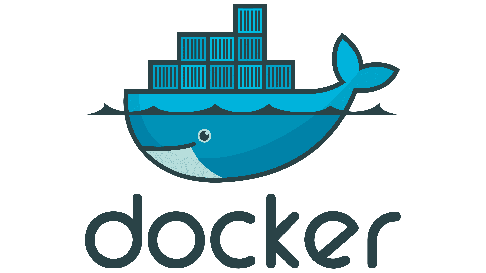

## Docker installation 

#### The installation was done on a Linux VM (Rocky) inside ESXi hypervisor, so all the commands will be noted as for Linux.

```
sudo dnf update
```

```
sudo dnf install -y dnf-utils device-mapper-persistent-data lvm2
```

```
sudo tee /etc/yum.repos.d/docker-ce.repo >/dev/null <<EOF
[docker-ce-stable]
name=Docker CE Stable - x86_64
baseurl=https://download.docker.com/linux/centos/9/x86_64/stable
enabled=1
gpgcheck=1
gpgkey=https://download.docker.com/linux/centos/gpg
EOF 
```

```
sudo dnf install docker-ce
```

```
sudo systemctl start docker 
sudo systemctl enable docker
```
###### To add the user to docker group ( so you won't be needing to execute docker commands using `sudo` every time)

```
sudo usermod -aG docker $USER
```

###### After you execute the command above execute to logout and login again, for the group changes to take place:

```
sudo su
su your_user
```
 
###### Use this command to make sure you have the privileges 

```
docker container ls
```

## Docker architecture

Docker uses a client-server architecture. The Docker client talks to the Docker daemon, which does the heavy lifting of building, running, and distributing your Docker containers. The Docker client and daemon can run on the same system, or you can connect a Docker client to a remote Docker daemon. The Docker client and daemon communicate using a REST API, over UNIX sockets or a network interface. Another Docker client is Docker Compose, that lets you work with applications consisting of a set of containers.


### The Docker daemon

The Docker daemon (`dockerd`) listens for Docker API requests and manages Docker objects such as images, containers, networks, and volumes. A daemon can also communicate with other daemons to manage Docker services.

### The Docker client

The Docker client (`docker`) is the primary way that many Docker users interact with Docker. When you use commands such as `docker run`, the client sends these commands to `dockerd`, which carries them out. The `docker` command uses the Docker API. The Docker client can communicate with more than one daemon.

### Docker registries

A Docker registry stores Docker images. Docker Hub is a public registry that anyone can use, and Docker looks for images on Docker Hub by default. You can even run your own private registry.

When you use the `docker pull` or `docker run` commands, Docker pulls the required images from your configured registry. When you use the `docker push` command, Docker pushes your image to your configured registry.

### Docker objects

When you use Docker, you are creating and using images, containers, networks, volumes, plugins, and other objects. This section is a brief overview of some of those objects.

#### Images

An image is a read-only template with instructions for creating a Docker container. Often, an image is based on another image, with some additional customization. For example, you may build an image which is based on the `ubuntu` image, but installs the Apache web server and your application, as well as the configuration details needed to make your application run.

You might create your own images or you might only use those created by others and published in a registry. To build your own image, you create a Dockerfile with a simple syntax for defining the steps needed to create the image and run it. Each instruction in a Dockerfile creates a layer in the image. When you change the Dockerfile and rebuild the image, only those layers which have changed are rebuilt. This is part of what makes images so lightweight, small, and fast, when compared to other virtualization technologies.

#### Containers
A container is a runnable instance of an image. You can create, start, stop, move, or delete a container using the Docker API or CLI. You can connect a container to one or more networks, attach storage to it, or even create a new image based on its current state.

By default, a container is relatively well isolated from other containers and its host machine. You can control how isolated a container's network, storage, or other underlying subsystems are from other containers or from the host machine.

A container is defined by its image as well as any configuration options you provide to it when you create or start it. When a container is removed, any changes to its state that aren't stored in persistent storage disappear.

##### Example `docker run` command
The following command runs an `ubuntu` container, attaches interactively to your local command-line session, and runs `/bin/bash`.

```console
 docker run -i -t ubuntu /bin/bash
```

When you run this command, the following happens (assuming you are using the default registry configuration):

1. If you don't have the `ubuntu` image locally, Docker pulls it from your configured registry, as though you had run `docker pull ubuntu` manually.
2. Docker creates a new container, as though you had run a `docker container create` command manually.    
3. Docker allocates a read-write filesystem to the container, as its final layer. This allows a running container to create or modify files and directories in its local filesystem.
4. Docker creates a network interface to connect the container to the default network, since you didn't specify any networking options. This includes assigning an IP address to the container. By default, containers can connect to external networks using the host machine's network connection.
5. Docker starts the container and executes `/bin/bash`. Because the container is running interactively and attached to your terminal (due to the `-i` and `-t` flags), you can provide input using your keyboard while Docker logs the output to your terminal.
6. When you run `exit` to terminate the `/bin/bash` command, the container stops but isn't removed. You can start it again or remove it.